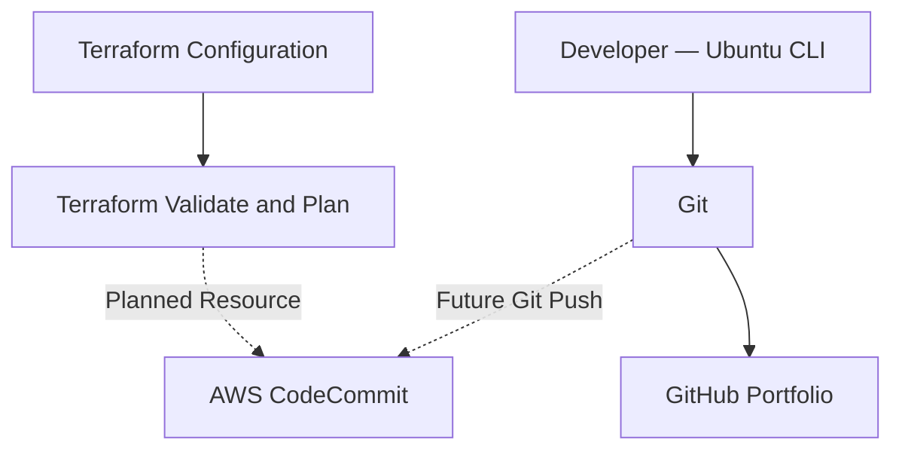

# AWS CodeCommit Terraform Lab

## Project Overview

This project demonstrates how to use Terraform, AWS CLI, Ubuntu Linux, and Git to plan an AWS CodeCommit repository in the `us-east-1` region.

**Project status: PLAN ONLY — no AWS resources deployed.**

## Architecture



The CodeCommit repository has not been deployed. GitHub is used to publish the lab documentation and Terraform code.

## AWS Services and Tools

- AWS CodeCommit
- AWS CLI
- Terraform 1.17.0
- Ubuntu Linux
- Git and GitHub

## Planned Infrastructure

| Resource | Configuration | Status |
|---|---|---|
| `aws_codecommit_repository.lab` | `terraform-codecommit-lab` | Planned |
| AWS Region | `us-east-1` | Configured |
| Repository ARN | Available after deployment | Not created |
| HTTPS clone URL | Available after deployment | Not created |

## AWS Discovery

The AWS CLI `list-repositories` command returned no existing CodeCommit repositories in `us-east-1`.

## Terraform Validation

Commands:

```bash
terraform init
terraform fmt
terraform validate
terraform plan -input=false -no-color
```

Observed results:

```text
Success! The configuration is valid.

Plan: 1 to add, 0 to change, 0 to destroy.
```

## Troubleshooting

During initialization, Terraform reported duplicate output definitions in `outputs.tf`.

The file was corrected to contain exactly three unique outputs:

- `repository_name`
- `repository_arn`
- `repository_clone_url_http`

Terraform initialization, validation, and planning subsequently succeeded.

## Deployment Status

No `terraform apply` was executed.

The AWS CodeCommit repository has not been created, and Git operations against CodeCommit have not been tested.

A successful Terraform plan does not guarantee that the AWS account has permission to create the repository.

## Security and Cost

- No AWS credentials or private keys are stored in the repository.
- Terraform state and variable files are excluded from Git.
- IAM permissions should follow least-privilege principles.
- AWS service availability and pricing should be reviewed before deployment.

## Future Improvements

- Verify CodeCommit creation eligibility.
- Deploy a repository only after explicit authorization.
- Configure secure Git authentication.
- Test repository cloning and pushing.
- Integrate a build pipeline.

## Validation Evidence

See `docs/validation-evidence.md` and `screenshots/codecommit-terraform-validation.png`.

